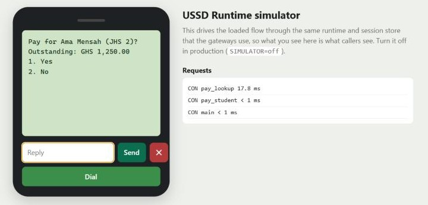
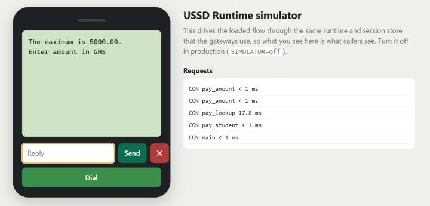
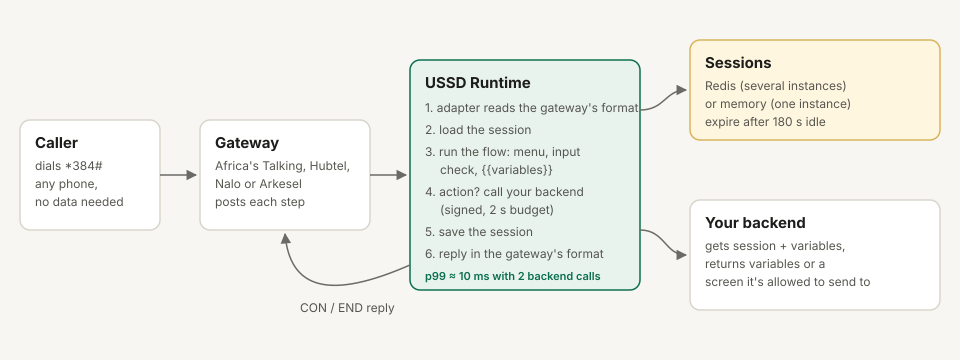

# USSD Runtime

Run the USSD menus you design in USSD Flow Studio, fast enough for a real phone session.

[](https://github.com/Jacksonoseikojo1122/ussd-runtime/actions/workflows/ci.yml)

USSD still reaches people without smartphones or data. But every network gives your server only a few seconds to answer before it drops the session, and every gateway (Africa's Talking, Hubtel, Nalo, Arkesel) speaks a different format.

USSD Runtime is one small Go service that:
- speaks all four gateway formats;
- keeps each caller's session;
- runs your menu, asks for typed answers and checks them;
- calls your backend when it needs data, with a hard time limit so a slow backend can't hang the caller.



## What you get

- **Runs USSD Flow Studio exports unchanged.** Flow Studio's own engine tests run against this runtime in CI, so the replies match.
- **Four gateways:** Africa's Talking, Hubtel, Nalo and Arkesel. Each format was taken from that provider's own docs.
- **Input screens** for text, digits, amounts and Ghana phone numbers. They're validated before your backend ever sees them, and three wrong answers end the session.
- **`{{variables}}` in prompts**, from the caller's answers or from your backend.
- **Actions:** signed HTTP calls to your backend with a 2-second budget. Your backend can only send the caller to screens you've allowed.
- **Sessions in Redis** for several instances, or in memory for one.
- **A phone simulator, Prometheus metrics and a load-test tool.**
- A distroless Docker image, a Render blueprint and a Kubernetes manifest.

## How fast

Measured on a laptop (Intel i7-10850H) with 50 callers at once, going through a payment flow where two of the six steps call a backend:

| Gateway | Requests/s | p50 | p99 |
| --- | --- | --- | --- |
| Africa's Talking | 19,438 | 1.80 ms | 9.69 ms |
| Hubtel | 18,628 | 1.89 ms | 9.82 ms |
| Nalo | 18,809 | 1.84 ms | 10.40 ms |
| Arkesel | 14,406 | 2.45 ms | 13.18 ms |

The first run had p99 at about 830 ms. The load test traced it to Go's default HTTP client opening a new connection for almost every backend call. The fix and the CI load test on Redis are in [operations.md](docs/operations.md).

## Quick start

```bash
git clone https://github.com/Jacksonoseikojo1122/ussd-runtime.git
cd ussd-runtime
SIMULATOR=on go run ./cmd/ussd-runtime    # open http://localhost:8080 and press Dial
```

```bash
curl -d "sessionId=s1&phoneNumber=%2B233241234567&text=" localhost:8080/ussd/africastalking
# CON Welcome to Demo Wallet
# 1. Buy airtime
# 2. Check balance
# 3. Exit
```

Then point your gateway at `https://<your-host>/ussd/<africastalking|hubtel|nalo|arkesel>?token=<GATEWAY_TOKEN>`.

## A flow with typed answers and a backend

```json
"pay_student": {
  "prompt": "Enter the student ID",
  "kind": "input",
  "input": { "name": "student_id", "type": "digits", "min_length": 4, "max_length": 8, "next": "pay_lookup" }
},
"pay_lookup": {
  "prompt": "Pay for {{student_name}} ({{class_name}})?\nOutstanding: GHS {{balance}}",
  "kind": "menu",
  "action": { "url": "$BACKEND_URL/ussd/student", "timeout_ms": 2000, "can_go_to": ["not_found"] },
  "options": [{ "key": "1", "label": "Yes", "next": "pay_amount" }, { "key": "2", "label": "No", "next": "bye" }]
}
```



The whole example is in [`flows/school-fees.json`](flows/school-fees.json), and its backend is in [`examples/demo-backend`](examples/demo-backend/main.go).

## Docs

| | |
| --- | --- |
| [Getting started](docs/getting-started.md) | Run the demo, run your Flow Studio export, add a backend, connect a gateway |
| [Flow format](docs/flows.md) | Screens, input types, variables, actions and the checks made when a flow loads |
| [Actions](docs/actions.md) | What your backend receives and returns; verifying the signature in Node, Python, PHP and Go |
| [Gateways](docs/gateways.md) | Each gateway's format, with links to its documentation |
| [Operations](docs/operations.md) | Load-test results, Redis, Docker, Render, Kubernetes, metrics and alerts |
| [OpenAPI spec](openapi.yaml) | Every endpoint, plus the action webhook |
| [llms.txt](llms.txt) | A summary for AI assistants helping you build flows |



## Related

- [USSD Flow Studio](https://github.com/Jacksonoseikojo1122/nextjs-ussd-flow-studio): design and test flows in the browser ([live](https://ussd-flow-studio.vercel.app)).
- [Webhook Relay](https://github.com/Jacksonoseikojo1122/webhook-relay): it uses the same signature scheme, so one helper can verify both.

## Author

Built by **[Jackson Kojo Osei](https://jacksonkojoosei.com)**, CTO in Accra, Ghana.
[LinkedIn](https://www.linkedin.com/in/jackson-kojo-osei-740846189) · [Project page](https://jacksonkojoosei.com/projects/ussd-runtime) · [All projects](https://jacksonkojoosei.com/projects)

## License

MIT
