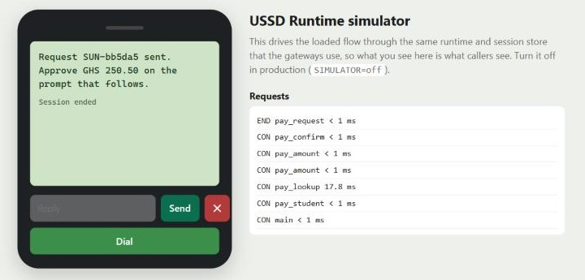

# Getting started

You need Go 1.27 or newer. Docker is optional.

## 1. Run the demo flow

```bash
git clone https://github.com/Jacksonoseikojo1122/ussd-runtime.git
cd ussd-runtime
SIMULATOR=on go run ./cmd/ussd-runtime     # http://localhost:8080
```

Open http://localhost:8080 and press **Dial**. The phone on the left runs `flows/demo-wallet.json`, the sample flow from [USSD Flow Studio](https://github.com/Jacksonoseikojo1122/nextjs-ussd-flow-studio). It uses the same runtime and session store as real gateway traffic.

Or talk to it the way Africa's Talking does:

```bash
curl -d "sessionId=s1&phoneNumber=%2B233241234567&networkCode=62001&serviceCode=*384#&text=" localhost:8080/ussd/africastalking
# CON Welcome to Demo Wallet
# 1. Buy airtime
# 2. Check balance
# 3. Exit
curl -d "sessionId=s1&phoneNumber=%2B233241234567&text=2" localhost:8080/ussd/africastalking
# END Your Demo Wallet balance is GHS 120.50.
```

## 2. Run your own Flow Studio design

1. Design the menu at [ussd-flow-studio.vercel.app](https://ussd-flow-studio.vercel.app).
2. Press **Export JSON**. It downloads `ussd-flow.json`; save it as `flows/my-flow.json`.
3. Run it:

```bash
FLOW_FILE=flows/my-flow.json SIMULATOR=on go run ./cmd/ussd-runtime
```

The runtime checks the flow when it starts. Errors such as a dangling link or a duplicate key stop it with a clear message. Warnings, such as a screen longer than Nalo's 120 characters, are logged and shown in the simulator.

## 3. Add typed answers and a backend

`flows/school-fees.json` shows the things Flow Studio can't do yet:
- asking for a student ID and an amount (input screens with validation);
- looking the student up in your system (an action);
- showing the result (`{{student_name}}` in the prompt).

Run the demo backend and the runtime in two terminals:

```bash
ACTION_SECRET=dev-secret go run ./examples/demo-backend
```

```bash
FLOW_FILE=flows/school-fees.json BACKEND_URL=http://localhost:9090 ACTION_SECRET=dev-secret SIMULATOR=on go run ./cmd/ussd-runtime
```

Dial, choose **1. Pay fees** and enter student `1001`:


Amounts are checked before anything reaches your backend:




## 4. Connect a gateway

Point your gateway's callback URL at the matching endpoint. See [gateways.md](gateways.md) for each one.

| Gateway | Callback URL |
| --- | --- |
| Africa's Talking | `https://<your-host>/ussd/africastalking?token=<GATEWAY_TOKEN>` |
| Hubtel | `https://<your-host>/ussd/hubtel?token=<GATEWAY_TOKEN>` |
| Nalo | `https://<your-host>/ussd/nalo?token=<GATEWAY_TOKEN>` |
| Arkesel | `https://<your-host>/ussd/arkesel?token=<GATEWAY_TOKEN>` |

## Configuration

| Variable | Default | Meaning |
| --- | --- | --- |
| `FLOW_FILE` | `flows/demo-wallet.json` | The flow to run |
| `PORT` | `8080` | HTTP port |
| `REDIS_URL` | none | `redis://` or `rediss://` URL. Without it, sessions live in memory, so run one instance only |
| `SESSION_TTL` | `180s` | How long an idle session is kept |
| `GATEWAY_TOKEN` | none | If set, gateway requests must include `?token=` or an `X-Gateway-Token` header |
| `ACTION_SECRET` | none | Key used to sign action calls to your backend |
| `SIMULATOR` | `off` | `on` serves the phone simulator at `/`. Keep it off in production |
| `BACKEND_URL` etc. | | Any `$VARIABLE` in an action URL is read from the environment |

Next: [flow format](flows.md) · [actions](actions.md) · [gateways](gateways.md) · [operations](operations.md)
